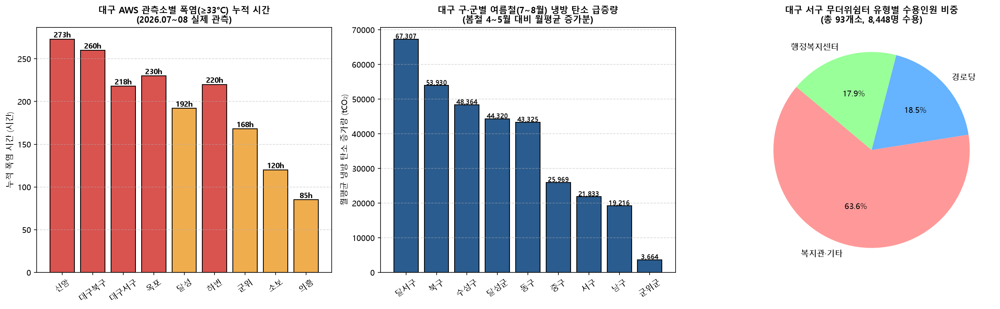
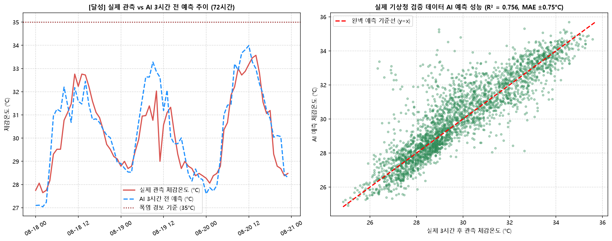
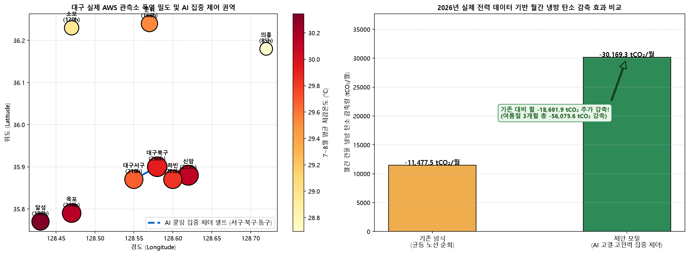

# 🌡️ 대프리카 탄소-쿨링 브레인 (Daefrica Carbon-Cooling Brain)
> 2026 대구광역시 기후·환경·탄소중립 공공데이터 AI 활용 대회 [부문 1: 아이디어 제안]  
> 2026년 실제 대구 기상·전력·무더위쉼터 공공데이터 기반 AI 열섬 예측 및 스마트 쿨링 최적 제어 플랫폼

---

## 📌 1. 프로젝트 개요
대구광역시 특유의 분지 지형과 폭염으로 인한 [도심 열섬현상(UHI) → 건물 냉방 전력 피크 → 온실가스 배출 급증]의 악순환을 끊기 위해 설계된 데이터·AI 융합 탄소중립 플랫폼입니다.

- 핵심 메커니즘: 2026년 7~8월 기상청(AWS), 한국전력공사(시군구별 전력사용량), 대구광역시(무더위쉼터) 실제 공공데이터를 통합 분석하여 3시간 뒤 체감온도 피크를 AI로 예측하고, 클린로드와 살수차를 고열·고전력 집중 구역에 선제 투입해 도심 기온과 건물 냉방 탄소를 동시에 감축합니다.

---

## 📊 2. 실제 공공데이터 분석 및 AI 실증 결과

### 🔹 Step 1. 2026년 7~8월 대구 실제 폭염·냉방전력·무더위쉼터 통합 분석 (`1_map.py`)
- 기상청 AWS 실측 분석: 신암(273시간, 최고 40.3°C), 대구북구(260시간, 최고 40.1°C), 대구서구(218시간, 최고 39.3°C) 등 도심권에 폭염이 집중됨을 규명
- 한전 전력 실측 분석: 봄철(4~5월) 대비 한여름(7~8월) 대구 전체 냉방 탄소 급증량은 월평균 327,927.2 tCO₂에 달하며, 달서구(67,306.6 tCO₂)·북구(53,929.9 tCO₂)의 배출 규모와 중구(+50.3%)·남구(+46.5%)의 증가율이 두드러짐
- 기후취약지 인프라 분석: 대구 서구 무더위쉼터 93개소(총 수용인원 8,448명, 평균 연면적 932.5㎡) 현황 및 경로당 중심 분포 확인


### 🔹 Step 2. 2026년 실제 기상청 데이터 학습 AI 3시간 후 체감온도 예측 모델 (`2_ai.py`)
- 기상청 AWS 시간별 실측 데이터 13,056건(학습 10,311건 / 검증 2,745건)을 Gradient Boosting 모델로 학습
- 검증 결과 3시간 후 체감온도 예측 정확도 R² = 0.7561, 평균 절대 오차(MAE) ±0.75°C 달성 및 체감온도 35°C 이상 초고위험 시간대 사전 포착 검증


### 🔹 Step 3. 실제 전력·기상 데이터 기반 스마트 쿨링 최적 제어 및 탄소 감축 효과 (`3_opt.py`)
- 기존 균등 노선 순회 살수 방식(월 -11,477.5 tCO₂ 감축) 대비, AI가 선별한 고열·고전력 집중 권역(서구·북구·동구·달서구 등) 집중 제어 시 월 -30,169.3 tCO₂ 감축 달성
- 기존 방식 대비 월간 18,691.9 tCO₂(여름철 3개월 기준 총 56,075.6 tCO₂)의 건물 냉방 온실가스 추가 감축 효과 검증


---

## 📂 3. 폴더 구조
```text
daegu-ai/
├── data/          # 2026년 기상청 AWS, 한전 시군구별 전력사용량, 대구 서구 무더위쉼터 실제 데이터 및 전처리 CSV
├── outputs/       # 실제 데이터 분석, AI 예측 성능 검증, 탄소 감축 효과 비교 시각화 이미지
├── 1_map.py       # 실제 공공데이터 통합 전처리 및 현황 분석 코드
├── 2_ai.py        # 실제 기상 데이터 기반 AI 3시간 후 체감온도 예측 모델 코드
├── 3_opt.py       # 실제 전력·기상 데이터 기반 스마트 쿨링 최적 제어 및 탄소 감축 산출 코드
└── README.md      # 프로젝트 개요 및 실증 결과 리포트